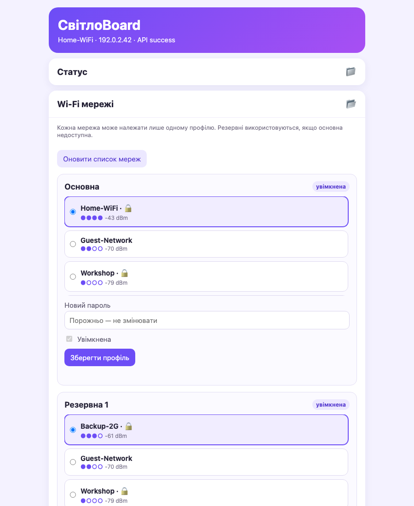

# SvitloBoard

SvitloBoard — це прошивка для ESP8266 та ESP32, яка періодично повідомляє про
доступність пристрою: через сервіс [СвітлоБот](https://svitlobot.in.ua) або GET-запит
на власну URL-адресу. Сам пристрій не веде графіки, не керує Telegram-каналом і не
визначає причину недоступності.

> **SvitloBoard 2.1 випущено.** На фізичній платі перевірено ESP-01S 1 МБ. Стан
> перевірки інших цілей наведено в [матриці тестування](docs/test-plan.md).

## Як це працює

Після першого запуску плата створює Wi-Fi мережу `SvitloBoard-XXXXXX` з паролем
`svitlobot`. У локальному веб-інтерфейсі потрібно вказати:

1. основну Wi-Fi мережу та, на платах із достатньою flash-пам'яттю, до двох резервних;
2. отримувача статусу: СвітлоБот із необов'язковим Channel Key або повний custom URL;
3. необов'язковий пароль адміністратора локального інтерфейсу.

Після збереження плата під'єднується до Wi-Fi й періодично звертається до вибраного
отримувача. Режим можна змінити пізніше у локальній панелі. Якщо основна мережа
недоступна, прошивка перевіряє резервні. Якщо не працює жодна з них, плата знову
відкриває точку доступу для виправлення налаштувань, не стираючи конфігурацію.

Інструкцію зі створення каналу та отримання ключа дивіться в
[офіційній інструкції СвітлоБота](https://svitlobot.in.ua/instructions?idx=1).

## Рознесення запитів кількох плат

Якщо 2–4 пристрої ділять спільне обмеження частоти API, увімкніть рознесення запитів
за NTP. На всіх платах задайте однакову кількість пристроїв, а кожній призначте
унікальний номер від 1 до цієї кількості. Прошивка відведе їм слоти з кроком 45 секунд:
для двох плат кожна надсилає раз на 90 секунд, для трьох — на 135, для чотирьох — на
180. Після запуску й відновлення Wi-Fi плата чекає свого наступного слота; пропущені
запити не накопичуються. Режим потребує NTP також із custom HTTP URL.

Після оновлення з версії без цього режиму він залишається вимкненим. Звичайний
інтервал ping зберігається окремо й знову діє після вимкнення рознесення.
Для незалежних точок живлення використовуйте
окремі ключі каналів: запит будь-якої плати підтримує спільний канал онлайн.
СвітлоБот вважає канал офлайн після чотирьох хвилин без запитів; у групі з трьох або
чотирьох плат один невдалий запит окремої плати вже може перевищити цей поріг для її
каналу. Деталі розкладу наведено в [документації прошивки](firmware/README.md).

## Локальна вебпанель

| Перше налаштування | Основна та резервні мережі |
| --- | --- |
|  |  |

## Підтримувані плати

| Платформа | Таргети |
| --- | --- |
| ESP8266 / ESP8285 | ESP-01 512 KiB, ESP-01/ESP-01S 1 MiB, D1 mini, NodeMCU v2, Sonoff Basic R2, Sonoff Basic R3 |
| ESP32 | ESP32 DevKit, ESP32-C3, ESP32-S3 |

Усі плати використовують той самий адаптивний вебінтерфейс із картками знайдених
Wi-Fi мереж. Прошивка приховує лише функції, яких немає в конкретній збірці: для
ESP-01 512 KiB такими функціями є лише OTA та експертний GPIO. Повний
перелік відмінностей наведено у [документації прошивки](firmware/README.md).

На Sonoff Basic R2/R3 реле примусово залишається вимкненим: SvitloBoard використовує ці
плати лише як індикатори доступності й не надає керування навантаженням.

## Прошивання

Готові образи доступні у браузерному інсталяторі на
[GitHub Pages](https://baskerville42.github.io/svitloboard/). Для першого прошивання
потрібні браузер із підтримкою Web Serial, USB-UART адаптер або вбудований USB
відповідної dev-плати та правильний режим завантажувача.

Версія на кшталт `2.2.0-dev.5526673` означає автоматичну збірку з `main`, яку
пропонує браузерний інсталятор; останні сім символів — коміт. Випуск із тегом
`v2.2.0` має версію `2.2.0` без `dev` чи `prod`, а його образи доступні у
[GitHub Releases](https://github.com/Baskerville42/svitloboard/releases).

Не від'єднуйте живлення під час запису. Для Sonoff корпус треба відкривати лише після
повного від'єднання від 230 В; ніколи не підключайте одночасно мережеву напругу й
USB-UART адаптер.

Розробники можуть зібрати всі дев'ять таргетів через PlatformIO:

```sh
pio run -d firmware
```

Окремі команди складання, структура артефактів та обмеження пам'яті описані у
[`firmware/README.md`](firmware/README.md).

## Основні можливості SvitloBoard 2

- до трьох Wi-Fi профілів із пріоритетом останньої успішної мережі та обмеженим часом спроб;
- recovery AP без автоматичного стирання налаштувань;
- два CRC-перевірені слоти конфігурації у LittleFS;
- вибір між вбудованим API СвітлоБота та повним custom URL під час першого й
  подальшого налаштування;
- перевірене HTTPS-з'єднання з hostname validation та кореневим сертифікатом;
- опційний розклад NTP для рознесення запитів 2–4 плат із кроком 45 секунд;
- швидкий локальний AJAX-інтерфейс і журнал діагностики;
- OTA на платах, де достатньо flash-пам'яті, із перевіркою маркера цільової плати;
- factory reset після чотирьох коротких циклів фізичного живлення;
- опційний ізольований цифровий вхід для термінового `channelPingOff` у повному профілі.

## Безпека й обмеження

SvitloBoard не може відрізнити зникнення електроенергії від втрати Wi-Fi, інтернету чи
живлення роутера. Для коректного моніторингу мережеве обладнання та плата мають отримувати
резервне живлення або слід використовувати окремий гальванічно ізольований датчик.

**Ніколи не підключайте 230 В, резистивний дільник або неізольовану саморобну схему
безпосередньо до GPIO.** Експертний вхід приймає лише низьковольтний цифровий сигнал від
гальванічно ізольованого модуля. Деталі й обмеження наведено в
[`docs/hardware-power-input.md`](docs/hardware-power-input.md).

OTA-маркер захищає від випадкового завантаження образу іншої плати, але не є
криптографічним підписом. Для СвітлоБота завжди використовується перевірений HTTPS.
Custom URL може починатися з `http://` або `https://`; HTTP не шифрує ключі чи інші
параметри URL, а HTTPS підтримує лише ланцюжки до вбудованого GTS Root R4 — без
`setInsecure()` і без довільних приватних CA.

## Документація

- [архітектура](docs/architecture.md);
- [план фізичного тестування](docs/test-plan.md);
- [план розвитку](docs/roadmap.md).

SvitloBoard 2 не читає EEPROM-налаштування старої прошивки SvitloBoard 1. Після такого
оновлення пристрій потрібно налаштувати заново. Внутрішня схема конфігурації ранніх
випусків SvitloBoard 2 мігрує автоматично.

## Ліцензія

Увесь проєкт поширюється за умовами [MIT License](LICENSE).

**Автор:** Alexander Tartmin — [baskerville42](https://github.com/baskerville42)
